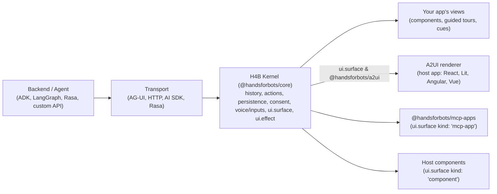

# Working with A2UI, MCP Apps, AG-UI and CopilotKit

Hands for Bots (H4B) is not a chat window, an agent framework or a UI specification; it is the client-side collaborative runtime inside your app that connects people, your GUI and any agent. This page explains the boundaries between H4B and adjacent standards and libraries, and how they complement each other.

## Where each piece sits

Today, `@handsforbots/core` implements `ui.surface` (unifying host components, MCP Apps and A2UI surface payloads) and `ui.effect`, `@handsforbots/transport-agui` maps AG-UI `ACTIVITY_SNAPSHOT` and `ACTIVITY_DELTA` events with `activityType: 'a2ui-surface'` (`A2UI_ACTIVITY_TYPE`) directly to `ui.surface` (`kind: 'a2ui'`, `op: 'snapshot' | 'delta'`) and `CUSTOM` `h4b.ui.surface` to `ui.surface`, and `@handsforbots/a2ui`, `@handsforbots/mcp-apps`, `@handsforbots/copilotkit` and `@handsforbots/expose-webmcp` are available. `@handsforbots/a2ui` is the headless A2UI 1.0 host plugin over `@a2ui/web_core` (presentation/rendering stays with the host app); `callRendererFunction` and catalog `functions` generation remain planned in [ADR 0020](../adr/0020-a2ui-e-mcp-apps.md).

| Tool or protocol | What it owns | How it works with H4B |
|---|---|---|
| **A2UI** | Declarative generative UI protocol (v1.0): component tree, data model and bidirectional function calls sent by an agent | H4B stays the client runtime, never the producer. **Available today:** `ui.surface` in `@handsforbots/core` stores and routes surface lifecycles, `transport-agui` forwards `a2ui-surface` activity events directly as `ui.surface` (`kind: 'a2ui'`, `op: 'snapshot' \| 'delta'`), and the headless `@handsforbots/a2ui` plugin over `@a2ui/web_core` manages surface models, routes A2UI `action` events to `allowActions` or `gui-event` signals, and reports `a2ui.dataModel` / `a2ui.capabilities` while your app brings the renderer and catalog. **Planned ([ADR 0020](../adr/0020-a2ui-e-mcp-apps.md)):** `callRendererFunction` and catalog `functions` generation from H4B actions |
| **MCP Apps** | MCP UI extension (`io.modelcontextprotocol/ui`) for sandboxed `ui://` HTML resources (`text/html;profile=mcp-app`) over JSON-RPC / `postMessage` | Delivered via `ui.surface` (`kind: 'mcp-app'` / `component: 'mcp-app'`). `@handsforbots/mcp-apps` mounts the `ui://` resource in a sandboxed iframe with strict CSP and bridges `tools/call` only to allowlisted H4B actions (`allowTools`, origin `'agent'`) |
| **AG-UI** | Event stream protocol between agents and frontends (messages, tool calls, state deltas, activity and custom events) | `@handsforbots/transport-agui` speaks AG-UI over HTTP POST + SSE (or an in-process agent), turns events into H4B stimuli and forwards `h4b.ui.effect`, `h4b.ui.surface`, sources/citations and `a2ui-surface` activity events directly into `ui.surface` |
| **CopilotKit** | React agentic UI framework with its own chat UI, agent hooks and built-in renderers for A2UI and MCP Apps | `@handsforbots/copilotkit` bridges H4B into CopilotKit Mode A (`useCopilotKitBridge` / `<CopilotKitBridge>`): H4B actions become CopilotKit frontend tools, context signals become agent context, and H4B adds voice, `menu`, inputs and WebMCP without duplicating chat or UI rendering |
| **WebMCP** | Browser API (`document.modelContext`) that exposes page capabilities as tools to external browser agents | `@handsforbots/expose-webmcp` publishes actions whose `exposeTo` includes `'agent'` and runs calls through the kernel queue (validation, `confirm`, `action.before` and history under route `'agent'`) |
| **`ui.surface` & `ui.effect` (H4B)** | Single persistent surface stimulus (`{ surfaceId?, kind?, op?, component?, payload?, slot?, messageId? }`) vs. ephemeral reactions (`{ name, value? }`) | Built into `@handsforbots/core` today: `ui.surface` unifies host components (`gallery`), MCP Apps and A2UI in one addressable lifecycle (`snapshot`/`delta`/`delete`), while `ui.effect` handles ephemeral reactions (scroll, highlight, sound, `cues`) with no mounted state or reload replay |

## How the pieces combine in practice

### 1. A collaborative app where user and agent share the interface

- **Context:** An interactive workspace, analytics dashboard or 3D editor where the person clicks controls, speaks commands, drops files or cancels mid-turn with `h4b.abort()` while the agent acts on the same screen.
- **How they divide the work:** Known screens, panels and highlights stay normal app components driven by declared H4B actions and `ui.effect` (`guided`, `cues`). H4B coordinates the turn queue, `voice`, `inputs`, `memory`, storage, `tab-sync` and `consent`. Host cards (`gallery`, status widgets) use `ui.surface` (`kind: 'component'`). When the agent needs to compose a dynamic collaborative form or side-by-side comparison using the app's own design system without shipping raw HTML or spawning an iframe, `ui.surface` (`kind: 'a2ui'`) delivers the payload in `core` and `transport-agui`, and `@handsforbots/a2ui` manages the headless A2UI 1.0 surface state over `@a2ui/web_core` and routes actions while your app renders the surface (`callRendererFunction` / catalog `functions` generation remains planned in [ADR 0020](../adr/0020-a2ui-e-mcp-apps.md)).
- **Why this split works:** Existing views keep full performance and type safety, A2UI handles only genuinely dynamic UI inside your catalog, and H4B keeps every modality, confirmation and cancellation in one shared history.

### 2. Adding rich agent UI and voice to an existing backend

- **Context:** A product backed by a custom HTTP endpoint, Laravel, Rails or Rasa API that already owns business logic and does not speak AG-UI.
- **How they divide the work:** `@handsforbots/transport-http`, `@handsforbots/transport-ai-sdk` or `@handsforbots/transport-rasa` translates that backend's responses and tool calls into H4B stimuli (including `ui.surface` and `ui.effect`). On the client, the app gets the same action registry, history, `memory`, `storage-local` / `storage-backend`, `consent` and `voice` layer.
- **Why this split works:** Teams add multimodal input, direct commands (`menu`), client-side actions and GUI effects without rewriting their backend or committing to a single agent framework first.

### 3. Embedding third-party interactive tools with MCP Apps

- **Context:** Your backend acts as an MCP client, calls an external MCP server (for example a billing widget, chart builder or ticket inspector) and receives a `ui://` HTML resource (`text/html;profile=mcp-app`).
- **How they divide the work:** The backend returns the resource via `ui.surface` (`kind: 'mcp-app'` / `component: 'mcp-app'`), and `@handsforbots/mcp-apps` (`mcpAppRenderer` or `mountMcpApp`) renders it in a sandboxed iframe (`allow-scripts`, restrictive CSP placed before app markup). If the embedded app calls `tools/call`, H4B only executes actions listed in `allowTools` with origin `'agent'`, subject to schema validation and `confirm`; `ui/message` and `ui/update-model-context` remain off unless explicitly enabled (`allowMessages`, `allowModelContext`).
- **Why this split works:** Untrusted third-party HTML stays isolated in an iframe with a `MessageChannel` bound to its first document, while still able to invoke narrow, audited capabilities in your host app.

### 4. Extending a CopilotKit app with voice, direct commands and WebMCP

- **Context:** A React application using CopilotKit in Mode A (CopilotKit owns the chat UI and agent connection), where CopilotKit already renders A2UI surfaces and MCP Apps.
- **How they divide the work:** Mount `<H4BProvider>` with `voice`, `menu`, `inputs` and `@handsforbots/expose-webmcp`, then connect both with `useCopilotKitBridge` (or `<CopilotKitBridge>`) from `@handsforbots/copilotkit`. CopilotKit keeps ownership of chat rendering, A2UI and MCP Apps; H4B feeds voice transcripts, direct commands, context signals and WebMCP calls into the same session and can speak agent answers back.
- **Why this split works:** There is no duplicated UI rendering or competing chat state—CopilotKit handles the React chat surface while H4B adds the collaborative modalities and action governance around the page.

## Declare actions once, use them everywhere

Each action registered in H4B defines a `name`, an input schema (`input` or `parameters`), a confirmation policy (`confirm` / `destructive`) and `exposeTo`. From that single declaration, one validated handler serves every surface:

- **In-app assistant:** transports advertise exposed actions as tools and run incoming `action.call` stimuli through the kernel queue.
- **Direct user commands:** `menu` slash commands, phrases, keyboard shortcuts and `h4b.runAction()` trigger the same action locally without an LLM round trip, while still recording it in history.
- **Browser agents:** `@handsforbots/expose-webmcp` publishes actions with `'agent'` in `exposeTo` to `document.modelContext`.
- **Sandboxed MCP Apps:** `@handsforbots/mcp-apps` bridges `tools/call` requests to actions named in `allowTools` with origin `'agent'`.
- **A2UI surfaces:** `@handsforbots/a2ui` routes surface `action` events to actions listed in `allowActions` (origin `'agent'`, with kernel validation and `confirm`) or `gui-event` signals; generating A2UI catalog `functions` definitions and routing `callRendererFunction` remain planned ([ADR 0020](../adr/0020-a2ui-e-mcp-apps.md)).

## When you do not need H4B

- **Your app lives only inside third-party chat hosts (Claude, ChatGPT) with no frontend of your own:** build an MCP server (with MCP Apps `ui://` resources if you need rich UI) rather than a client-side runtime.
- **You use CopilotKit Mode A for text-only chat and its built-in A2UI / MCP Apps renderers:** if you do not need voice, `menu` commands, `inputs`, WebMCP or H4B persistence/consent plugins, CopilotKit alone is simpler.
- **You are building a small prototype that only shows one or two static cards:** plain transport calls or direct components are enough until you need shared actions, turn interruption or multimodal input.

## Further reading

- [Concepts](./concepts.md)
- [Plugins](./plugins.md)
- [References: A2UI and MCP Apps](./references.md#a2ui-and-mcp-apps)
- [ADR 0020 — A2UI e MCP Apps](../adr/0020-a2ui-e-mcp-apps.md)
