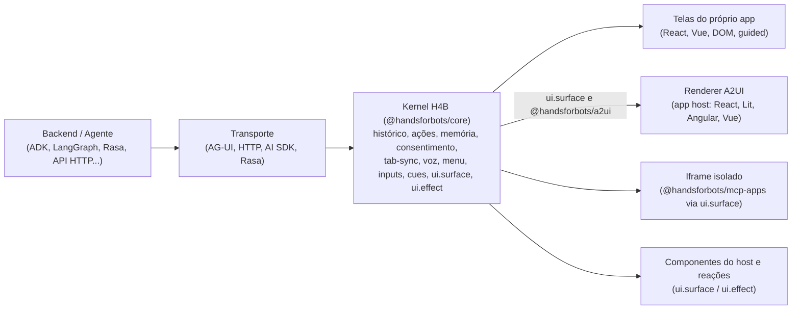

# Trabalhando com A2UI, MCP Apps, AG-UI e CopilotKit

O H4B não é uma janela de chat, nem um framework de agente, nem uma especificação de UI: é o runtime colaborativo no cliente que liga pessoas, a sua interface e qualquer agente. Esta página explica as fronteiras entre o H4B e os padrões ou bibliotecas vizinhos, e como eles se complementam.

## Onde cada peça entra

Hoje, o `@handsforbots/core` já implementa `ui.surface` (unificando componentes do host, MCP Apps e payloads de superfícies A2UI) e `ui.effect`, o `@handsforbots/transport-agui` mapeia eventos `ACTIVITY_SNAPSHOT` e `ACTIVITY_DELTA` com `activityType: 'a2ui-surface'` (`A2UI_ACTIVITY_TYPE`) diretamente para `ui.surface` (`kind: 'a2ui'`, `op: 'snapshot' | 'delta'`) e `CUSTOM` `h4b.ui.surface` para `ui.surface`, e `@handsforbots/a2ui`, `@handsforbots/mcp-apps`, `@handsforbots/copilotkit` e `@handsforbots/expose-webmcp` já estão disponíveis. O `@handsforbots/a2ui` é o plugin headless de host A2UI 1.0 sobre `@a2ui/web_core` (a renderização continua com o app host); a geração de `functions` no catálogo e `callRendererFunction` seguem planejados no [ADR 0020](../adr/0020-a2ui-e-mcp-apps.md).

| Ferramenta ou protocolo | O que resolve | Como trabalha com o H4B |
|---|---|---|
| **A2UI** | Protocolo declarativo de UI generativa (árvore de componentes, modelo de dados e chamadas de função; v1.0). | **Hoje:** `ui.surface` no `@handsforbots/core` armazena e roteia o ciclo de vida das superfícies, `@handsforbots/transport-agui` mapeia eventos de atividade `a2ui-surface` diretamente para `ui.surface` (`kind: 'a2ui'`, `op: 'snapshot' \| 'delta'`), e o plugin headless `@handsforbots/a2ui` sobre `@a2ui/web_core` mantém os modelos de superfície, roteia eventos `action` para `allowActions` ou sinais `gui-event` e reporta `a2ui.dataModel` / `a2ui.capabilities` enquanto seu app traz o renderer e o catálogo. **Planejado ([ADR 0020](../adr/0020-a2ui-e-mcp-apps.md)):** `callRendererFunction` e geração de `functions` no catálogo a partir das ações do H4B. |
| **MCP Apps** | Extensão de UI do MCP (`io.modelcontextprotocol/ui`, recursos HTML `ui://`) para ferramentas interativas em iframe isolado. | **Hoje:** entregue via `ui.surface` (`kind: 'mcp-app'` / `component: 'mcp-app'`). `@handsforbots/mcp-apps` (`mountMcpApp`, `mcpAppRenderer`) atua como host na sua página com sandbox, CSP rígida e ponte `MessageChannel`, ligando `tools/call` às ações listadas em `allowTools`. |
| **AG-UI** | Protocolo de eventos em streaming entre backend de agente e frontend. | **Hoje:** `@handsforbots/transport-agui` implementa o protocolo como transporte do H4B (`agui()`), mapeando `h4b.ui.effect`, `h4b.ui.surface`, fontes/citações e atividades `a2ui-surface` diretamente para `ui.surface`. |
| **CopilotKit** | Framework React para UI de copilotos e chat, com suporte embutido a renderers de A2UI e MCP Apps no Modo A. | **Hoje:** `@handsforbots/copilotkit` (`useCopilotKitBridge`, `<CopilotKitBridge>`) conecta ações e contexto do H4B ao CopilotKit sem duplicar a renderização de UI que ele já faz. |
| **WebMCP** | API do navegador (`document.modelContext`) que expõe ações da página a agentes externos no browser. | **Hoje:** `@handsforbots/expose-webmcp` publica ações do H4B com `exposeTo` contendo `'agent'`, sob a mesma validação, confirmação e registro no histórico (rota `agent`). |
| **`ui.surface` e `ui.effect` (H4B)** | Estímulo único de superfície persistente (`{ surfaceId?, kind?, op?, component?, payload?, slot?, messageId? }`) vs. reações efêmeras (`{ name, value? }`). | **Hoje:** nativos no `@handsforbots/core`: `ui.surface` unifica componentes do host (`gallery`), MCP Apps e A2UI num ciclo de vida endereçável (`snapshot`/`delta`/`delete`), enquanto `ui.effect` cuida de reações pontuais (rolagem, destaque, som, `cues`) sem estado montado nem replay no reload. |

## Como as peças se combinam na prática

### 1. Um app colaborativo onde pessoa e agente dividem a interface

- **Contexto:** Um workspace interativo, painel operacional ou editor com canvas/3D onde usuário e assistente atuam sobre a mesma tela.
- **Como o trabalho se divide:** O usuário clica, fala (`voice`), usa comandos diretos (`menu`) ou cancela o turno em andamento com `h4b.abort()` (ou interrompe com `h4b.interrupt()`). O agente aciona ações declaradas no H4B para abrir telas conhecidas, filtrar dados ou destacar elementos (`guided`, `cues`). As telas fixas continuam sendo componentes normais do app (React, Vue ou DOM). Cartões do host (`gallery`, widgets de status) usam `ui.surface` (`kind: 'component'`). Quando o agente precisar compor na hora um formulário ou comparativo usando o catálogo do próprio app — sem HTML solto nem peso de iframe — `ui.surface` (`kind: 'a2ui'`) entrega o payload no `core` e no `transport-agui`, e `@handsforbots/a2ui` mantém o estado headless das superfícies A2UI 1.0 sobre `@a2ui/web_core` e roteia ações enquanto seu app renderiza a superfície (`callRendererFunction` e geração de `functions` no catálogo seguem planejados no [ADR 0020](../adr/0020-a2ui-e-mcp-apps.md)).
- **Por que essa divisão funciona:** Cada camada faz só o que precisa: a interface principal mantém estado e performance nativos do app, o H4B coordena turnos, histórico, persistência, consentimento e modalidades, e a UI declarativa entra apenas para trechos compostos dinamicamente pelo agente.

### 2. Levar UI rica de agente e voz a um backend já existente

- **Contexto:** Uma aplicação com backend próprio — uma API HTTP sob medida, Laravel, Rails ou um servidor Rasa — que não fala AG-UI nem será reescrita para adotar outro runtime de agente.
- **Como o trabalho se divide:** O frontend conecta o backend usando `@handsforbots/transport-http` (`http`, `universalLLM`, `openAICompatible`), `@handsforbots/transport-rasa` ou `@handsforbots/transport-ai-sdk`. Todo o restante no cliente — registro e validação de ações, `voice`, `menu`, `inputs`, `memory`, `storage-local`/`storage-backend`, `tab-sync`, `consent`, `ui.surface` e `ui.effect` — continua idêntico.
- **Por que essa divisão funciona:** Trocar ou manter o protocolo do servidor não obriga a abrir mão de voz, comandos instantâneos, persistência criptografada ou controle de privacidade no navegador.

### 3. Embutir ferramentas interativas de terceiros com MCP Apps

- **Contexto:** O backend atua como cliente MCP e recebe de um servidor MCP externo um recurso HTML `ui://` (`text/html;profile=mcp-app`) para exibir uma ferramenta interativa de terceiro dentro do produto.
- **Como o trabalho se divide:** O backend repassa o recurso via `ui.surface` (`kind: 'mcp-app'` / `component: 'mcp-app'`), e `@handsforbots/mcp-apps` renderiza a ferramenta num iframe isolado (`sandbox="allow-scripts"`, origem opaca) com CSP restritiva e ponte JSON-RPC sobre `MessageChannel`. Chamadas `tools/call` vindas do iframe só alcançam as ações do H4B listadas explicitamente em `allowTools`, executadas com origem `'agent'`.
- **Por que essa divisão funciona:** Código HTML de terceiros fica isolado do DOM e das credenciais da aplicação principal, enquanto interações autorizadas ainda passam pela validação, confirmação e trilha de histórico do kernel.

### 4. Estender um app CopilotKit com voz, comandos diretos e WebMCP

- **Contexto:** Uma aplicação React que já usa o CopilotKit como dono da experiência de chat (Modo A), aproveitando os renderers embutidos do CopilotKit para A2UI e MCP Apps.
- **Como o trabalho se divide:** `<CopilotKitProvider>` continua responsável pelo chat e pela renderização de A2UI e MCP Apps. Ao adicionar `<H4BProvider>` e `useCopilotKitBridge()` de `@handsforbots/copilotkit`, o app ganha `voice` (entrada e saída de fala, barge-in), `menu` (comandos sem LLM espelhados no histórico), `inputs` (câmera, arquivos, sensores, eventos da GUI) e `expose-webmcp`, sem montar renderizadores paralelos do H4B.
- **Por que essa divisão funciona:** Não há duplicação de chat nem disputa por quem renderiza A2UI/MCP Apps; o H4B entra apenas onde traz capacidades que faltavam no cliente.

## Declare as ações uma vez, use em todo lugar

Uma ação registrada no H4B (`name`, schema de entrada, `confirm` / `destructive` e `exposeTo`) usa o mesmo contrato de validação, confirmação e histórico em todos os pontos de entrada:

- **Assistente do app (tool calls):** o backend recebe as ações permitidas para `'assistant'` e as aciona via `action.call`.
- **Comandos diretos do usuário (`menu` e atalhos):** o usuário dispara a ação sem passar pelo LLM (rota `direct`, registrada no histórico para o turno seguinte).
- **Agentes do navegador (`expose-webmcp`):** ações com `'agent'` em `exposeTo` ficam acessíveis via `document.modelContext` (rota `agent`).
- **MCP Apps isolados (`allowTools`):** ferramentas dentro de `@handsforbots/mcp-apps` só chamam as ações liberadas na lista, também com origem `'agent'`.
- **Superfícies A2UI:** `@handsforbots/a2ui` roteia eventos `action` da superfície para ações listadas em `allowActions` (origem `'agent'`, com validação e `confirm` do kernel) ou sinais `gui-event`; gerar definições de `functions` do catálogo A2UI e rotear `callRendererFunction` seguem planejados ([ADR 0020](../adr/0020-a2ui-e-mcp-apps.md)).

## Quando você não precisa do H4B

- **O produto vive só dentro de hosts de terceiros (Claude, ChatGPT), sem frontend próprio:** publique um servidor MCP com recursos `ui://` (MCP Apps). O host de terceiros já fornece a janela e o runtime da interface.
- **App React com CopilotKit no Modo A que só precisa de chat em texto e dos renderers embutidos de A2UI/MCP Apps:** se você não precisa de `voice`, `menu`, `inputs`, `expose-webmcp`, `tab-sync`, nem de persistência/consentimento próprios do H4B, o CopilotKit sozinho já resolve.
- **Protótipo pequeno com um ou dois cartões fixos:** uma chamada simples à API do seu modelo ou SDK com componentes locais diretos costuma ser suficiente, sem precisar de um runtime de cliente com plugins.

## Leia também

- [Conceitos](./concepts.md): sinais, turnos, estímulos, rotas e ações
- [Plugins](./plugins.md): opções de `transport-agui`, `mcp-apps`, `copilotkit`, `expose-webmcp`, `voice` e `menu`
- [Referências → A2UI e MCP Apps](./references.md#a2ui-e-mcp-apps): especificações e bibliotecas usadas como base
- [ADR 0020 — A2UI e MCP Apps](../adr/0020-a2ui-e-mcp-apps.md): decisão arquitetural entre `ui.surface`, `ui.effect` e `mcp-apps`
